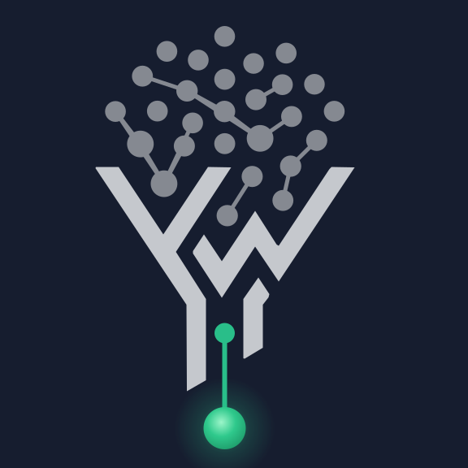
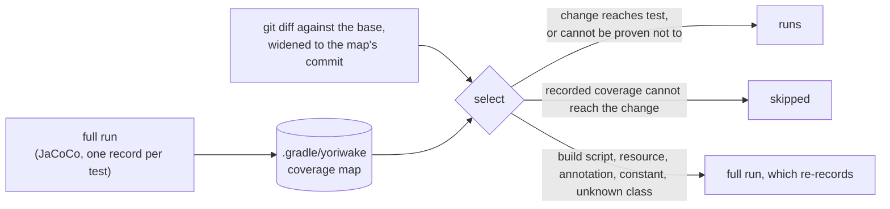

<p align="center">
  
</p>

<h1 align="center">yoriwake</h1>

<p align="center">
  <a href="https://plugins.gradle.org/plugin/io.github.zeuspizza.yoriwake"></a>
  <a href="LICENSE"></a>
  <a href="https://github.com/zeuspizza/yoriwake/actions/workflows/verify.yml"></a>
  <a href="CONTRIBUTING.md#coverage"></a>
</p>

<p align="center">
  Run only the tests your change can affect.
</p>

**yoriwake** (選り分け, *yo-ri-wa-ke*, Japanese for sorting out) is a Gradle plugin that records
which code each test executes, then on later runs skips the tests a change cannot reach. When it
cannot prove that skipping is safe, it runs the whole suite and tells you why. It runs locally,
inside your build: no service, no account.

## Why

Gradle reruns a test task whenever any of its inputs changed, and then it runs all of it. On a
suite that takes minutes, most of those tests have nothing to do with the line you just edited.
yoriwake adds test selection inside the task, decided from recorded per-test coverage rather than
from build history, so the answer is a rule you can check, not a prediction.

It is meant for:

- the edit-test loop, a developer's or an AI agent's, on a suite that takes more than a couple of
  minutes;
- pull-request CI, with the full suite still running after merge, nightly or before a release.

## Features

- **Opt-in.** Without `-Pyoriwake.select` nothing is ever skipped; runs only record.
- **Refuses rather than guesses.** A change coverage cannot see, such as a build script, a
  resource, an annotation or a changed constant, runs everything, and the run says which.
- **New tests always run.** A test the map has never seen, or never saw pass, is never skipped.
- **Explains every decision.** A console summary per run, and a file with one row per test giving
  its verdict and the rule that decided it.
- **Tells you up front whether it will help.** `yoriwakeAuditTest` reads the map, runs no tests,
  and reports how much of the suite a change reaches and what blocks narrowing, each blocker with
  its remedy or a plain "no remedy".
- **Pin what must always run.** `@Tag("yoriwake-always-run")` or `yoriwake { alwaysRun.add(...) }`.
- **An old map costs speed, never safety.** Selection widens the diff back to the commit the map
  was recorded at.
- **Java, Kotlin and Android unit tests** on the JUnit Platform.
- **[GitHub Action](https://github.com/zeuspizza/yoriwake-action)** that caches the map and picks
  the flags per event.

## Quick start

Apply the plugin next to `jacoco`, which it requires and scopes:

```kotlin
plugins {
    java
    jacoco
    id("io.github.zeuspizza.yoriwake") version "0.2.0"
}
```

Then:

```bash
./gradlew test                      # runs everything and records a coverage map
./gradlew yoriwakeAuditTest         # what selection could do on this suite, before trusting it
./gradlew test -Pyoriwake.select    # runs only the tests the change reaches
```

Run the audit first. Most of its answers are refusals rather than low numbers: it is built to tell
you not to bother when selection would not pay on your suite.

A selecting run says what it decided:

```
[yoriwake] :test selecting against 6aa07c0 (merge base with the branch upstream): 1 changed classes, 0 paths coverage cannot see
[yoriwake] of 593 tests discovered: reaches-change=47 not-known-to-pass=5 skipped=541
```

`.gradle/yoriwake/<task>-<hash>/decisions.tsv` holds one row per test with its verdict and rule.
`yoriwakeExplainTest` tells you, for the change in front of you, what would run and which class
forces a full run if one does.

## How it works



1. **Record.** A run of the whole suite records which classes each test executed, plus what its
   test JVM loaded, read or initialised once for every later test. Plain text, outside `build/`.
2. **Diff.** With `-Pyoriwake.select`, the change set is the diff against the merge base, widened
   back to the commit the map was recorded at.
3. **Select.** A JUnit Platform filter skips each test whose record cannot reach the change.
4. **Refuse.** Anything coverage cannot see runs everything and says why.
   [The full list](docs/reference.md#when-it-refuses-to-select).

## Limits

yoriwake sees only what happens inside the test JVM. A test that depends on a change through
something else, such as a database, another process or a file kept between test JVMs, can be
skipped when it should have failed, so keep a full run after merge or nightly. Order-dependent
tests need pinning.

It also does not pay everywhere. Recording costs extra time, Gradle configuration and JVM start do
not shrink, and on short suites it is usually slower, not faster. To weigh the recording cost on
your build, run `./gradlew yoriwakeAuditTest -Pyoriwake.audit.measureToll` with the two timings
[`scripts/measure-toll.sh`](scripts/measure-toll.sh) takes.

Not supported or declined: Gradle Isolated Projects, TestNG in-JVM parallelism, and Gradle below
8.14. A JUnit suite that runs tests in parallel inside one JVM is declined unless it opts in with
`-Pyoriwake.recordSequentially` (off by default): recording runs then run its tests one at a time,
which takes longer, and selecting runs keep its parallel scheduling. A failure that shows only when
tests run in parallel is outside what such a map sees;
[recording a parallel suite](docs/reference.md#recording-a-parallel-suite-one-test-at-a-time). Linux, macOS and Windows are supported; [on Windows](docs/reference.md#windows), paths over
260 characters need `core.longpaths`. A map is per operating system. Plain JUnit 4 and TestNG are recorded but always run in full;
JUnit 4 narrows through the vintage engine. A suite whose tests share setup in one JVM narrows
less; [recording each class in its own JVM](docs/reference.md#recording-each-test-class-in-its-own-jvm)
helps, at several times the recording cost. Every case:
[what is not supported](docs/reference.md#what-is-not-supported).

## Requirements

The Gradle versions, JDKs, operating systems and test engines each release is tested on are in the
[supported matrix](docs/reference.md#supported-matrix). It also needs `git` on `PATH` and a project
applying `java`, an Android plugin, or Kotlin Multiplatform with a JVM target
([the shapes tested](docs/reference.md#supported-hosts)).

## CI

On GitHub Actions, use [yoriwake-action](https://github.com/zeuspizza/yoriwake-action): it caches
the map, fetches the history selection needs, records on the default branch and selects on pull
requests. Elsewhere, cache `.gradle/yoriwake` and fetch enough history to reach the diff base:
[the CI recipe](docs/reference.md#ci). Measured entries for one test task were 0.07 to 2.76 MB:
[how much cache it takes](docs/reference.md#how-much-cache-it-takes).

## How well it works

It is measured on open-source projects by generating edits that break tests and checking whether
a selecting run misses the failures they cause. On most projects measured, most changes still ran
the whole suite, either because a change reached nearly every test or because the plugin could not
prove a narrower run safe. [The results, the method, and what that sample cannot
show](docs/benchmarks.md).

yoriwake is not a better version of Develocity Predictive Test Selection, a hosted service that
learns from build history. It is local and free, and it would rather run everything than guess.
[Prior art](docs/reference.md#prior-art).

## Documentation

- [Reference](docs/reference.md): how it works, every property and task, what is not supported,
  upgrading, prior art
- [Contract](docs/contract.md): the properties and files the plugin and the agent share
- [Benchmarks](docs/benchmarks.md): the projects, the method, and every published figure
- [Contributing](CONTRIBUTING.md): building, testing, what a change to selection must prove
- [Changelog](CHANGELOG.md): each release, and what it does to an existing map
- [Security](SECURITY.md): reporting a vulnerability, and [verifying a release](SECURITY.md#verifying-a-release)

## Licence

Apache-2.0, see [LICENSE](LICENSE); [NOTICE](NOTICE) lists what is shaded into the jars.
